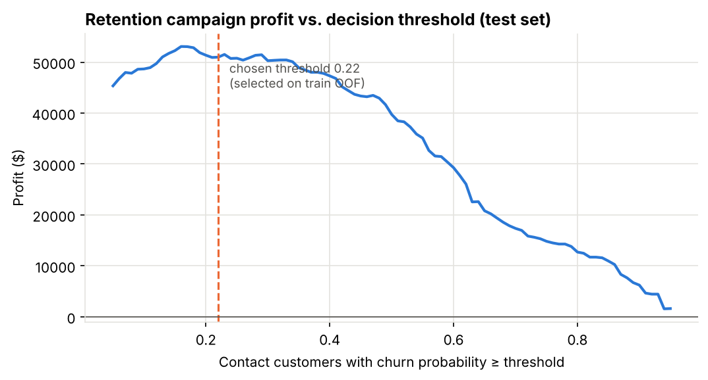
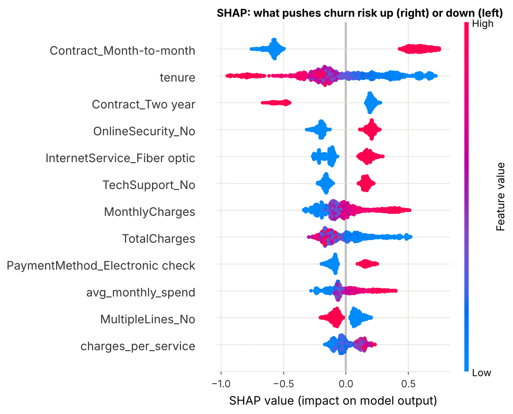

# Churn Prediction Service: From Model to Business Decision

A production-style ML project. It predicts which telecom customers will cancel, turns the predictions into a
**profit-maximising retention policy**, and serves the model behind a **validated REST API** in **Docker**,
with tests and CI.

Most churn notebooks stop at "accuracy = 80%". This project answers the question a business actually asks:
*who should we call, and how much money does the model make us compared with what we do today?*

## Results (held-out test set, 1,409 customers)

| | Value |
|---|---|
| ROC-AUC | **0.847** |
| PR-AUC (churn base rate 26.5%) | **0.660** |
| Brier score (after isotonic calibration) | 0.135 |
| Recall / precision at the chosen threshold (0.22) | 82.6% / 48.5% |
| **Campaign profit** | **$50,987** |

**Profit compared with simpler policies** (same test customers, same campaign economics):

| Policy | Profit |
|---|---|
| Contact nobody | $0 |
| Contact everyone | $27,524 |
| Rule of thumb: contact all month-to-month customers | $45,296 |
| Model with the default 0.5 threshold | $39,743 |
| **Model with the profit-optimised threshold** | **$50,987** (+13% vs the best rule, +28% vs the 0.5 threshold) |

> Campaign economics, set in `src/churn/config.py`: contacting a customer costs $50. The offer saves 30% of
> would-be churners. A saved customer is worth 12 months of their monthly charges. Change these and re-train.



## Model comparison (5-fold stratified CV on the training set)

| Model | ROC-AUC | PR-AUC | Brier |
|---|---|---|---|
| Baseline (predict the prior) | 0.500 | 0.265 | 0.195 |
| Logistic regression | 0.847 ± 0.011 | 0.662 ± 0.014 | 0.134 |
| Random forest | 0.847 ± 0.009 | 0.661 ± 0.021 | 0.135 |
| LightGBM (default) | 0.844 ± 0.009 | 0.657 ± 0.017 | 0.137 |
| **LightGBM (tuned, 25-trial random search)** | **0.849 ± 0.011** | **0.669 ± 0.021** | 0.134 |

**An honest takeaway:** the tuned LightGBM wins, but by less than one standard deviation over logistic
regression. On a small tabular dataset with strong, mostly monotonic signals, a linear model gets almost all
the way. In production I would seriously consider shipping the logistic regression for its simplicity and
interpretability. The profit-optimised threshold was worth far more ($11k) than the choice of algorithm.

## What drives churn (SHAP)


Month-to-month contracts, short tenure, fiber-optic internet without online security or tech support, and
electronic-check payment raise churn risk. Two-year contracts and long tenure lower it. Each of these suggests
an action: offer contract upgrades, bundle security and support, and nudge customers toward auto-pay.

## Engineering highlights
- **No leakage:** feature engineering and preprocessing live inside one sklearn `Pipeline`, so they are re-fit within every CV fold. The test set is used exactly once.
- **Threshold chosen on out-of-fold training predictions**, never on test data.
- **Calibrated probabilities** (isotonic, `reports/figures/calibration.png`). The expected-profit rule assumes "0.3" really means a 30% chance.
- **Feature engineering:** service count, charges per service, average historical spend, a price-increase ratio, and tenure buckets.
- **Data cleaning detail:** `TotalCharges` is blank for brand-new customers. These are customers who have not been billed yet, so the value is 0 (not missing), and the rows are kept.
- **API:** FastAPI with strict Pydantic schemas (enums, ranges), `/predict`, `/predict/batch`, `/health`, and auto-generated docs at `/docs`.
- **Quality:** 9 pytest tests (feature logic, profit maths, API contract with a stub model), ruff, and GitHub Actions CI.

## Run it
```bash
pip install -r requirements-dev.txt
make train     # downloads data, trains, writes models/ and reports/
make serve     # http://localhost:8000/docs
make test
make docker    # build and run the API container
```

```bash
curl -X POST localhost:8000/predict -H 'Content-Type: application/json' -d '{
  "gender":"Female","SeniorCitizen":0,"Partner":"No","Dependents":"No","tenure":3,
  "PhoneService":"Yes","MultipleLines":"No","InternetService":"Fiber optic",
  "OnlineSecurity":"No","OnlineBackup":"No","DeviceProtection":"No","TechSupport":"No",
  "StreamingTV":"Yes","StreamingMovies":"Yes","Contract":"Month-to-month",
  "PaperlessBilling":"Yes","PaymentMethod":"Electronic check",
  "MonthlyCharges":95.5,"TotalCharges":280.3}'
# {"churn_probability":0.7991,"risk_band":"high","contact":true}
```

## Project layout
```
src/churn/
  data.py       download + cleaning
  features.py   FeatureEngineer transformer + ColumnTransformer
  business.py   campaign profit, profit curve, optimal threshold
  train.py      CV comparison, tuning, calibration, threshold selection, final evaluation
  plots.py      ROC/PR, calibration, profit curve, SHAP
  api.py        FastAPI service
tests/          unit + API tests
models/         trained model artifact (joblib)
reports/        metrics.json, cv_model_comparison.csv, figures/
```

## Limitations and next steps
- A single snapshot dataset, with no time dimension, so drift cannot be checked. In production I'd train on month *t*, validate on *t+1*, and monitor feature drift (PSI).
- The 30% save rate is an assumption. An uplift model trained on an A/B-tested campaign would target customers who are *persuadable*, not only those *at risk*.

## Data
[IBM Telco Customer Churn](https://github.com/IBM/telco-customer-churn-on-icp4d), 7,043 customers, 21 columns.
