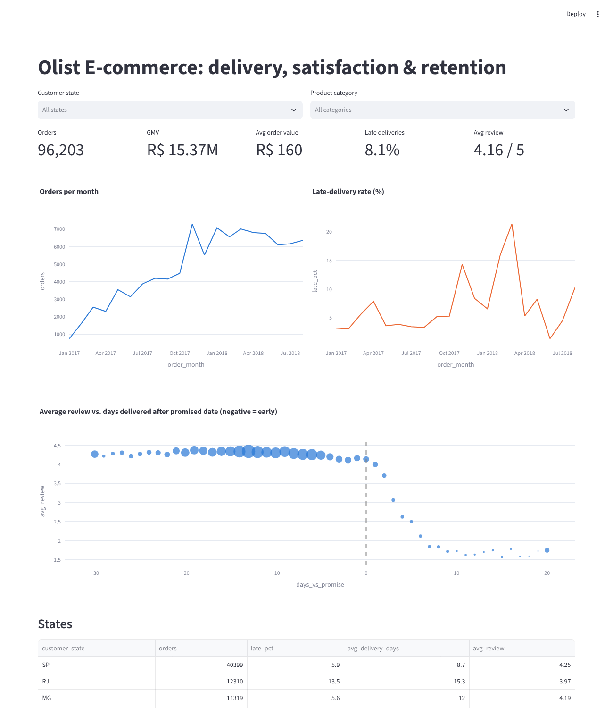
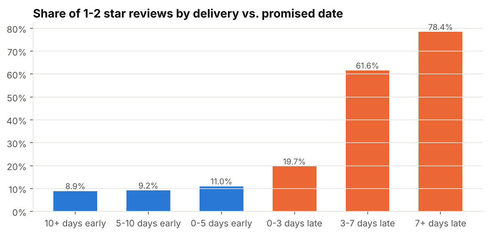

# Olist E-commerce Analytics: How Late Deliveries Drive Bad Reviews

An end-to-end analytics project on **~100k real orders** from Olist, a Brazilian e-commerce marketplace
(2016–2018). Raw CSVs go into a **DuckDB SQL warehouse**. On top of it sit cohort retention, RFM
segmentation, hypothesis tests, a regression with controls, and an interactive **Streamlit** dashboard.
The project ends with recommendations a business could act on.



## Business questions
1. How healthy is growth, and do customers come back?
2. What drives 1–2 star reviews? Is it the product, the price, or the logistics?
3. Which customer segments hold the revenue, and where should retention spend go?

## Key findings
Numbers come from `reports/results.json`, which is regenerated by `make report`.

| # | Finding | Evidence |
|---|---------|----------|
| 1 | **Late delivery is the strongest driver of negative reviews.** 8.0% of orders arrive late, yet they account for **34% of all 1–2★ reviews**. | Negative-review rate is 54.1% when late vs 9.2% on time. Welch t = −89.4, p < 1e-300. |
| 2 | The effect holds **after controlling** for order value, freight, item count, category and state. | Logistic regression: adjusted **odds ratio 11.9** (95% CI 11.3–12.6) |
| 3 | Satisfaction falls off a **cliff at the promised date**. Arriving early earns no extra reward. | 1–2★ share: 8.9% (10+ days early), 11.0% (0–5 days early), 19.7% (0–3 days late), 61.6% (3–7 days late), **78.4%** (7+ days late) |
| 4 | Lateness is **regional and seasonal**. | AL (24%) and MA (20%) are worst. Late rate spiked to **21% in Mar 2018**, after the Nov 2017 Black Friday peak. Cross-state shipments are late 9.3% of the time vs 6.1% within a state. |
| 5 | **Retention is close to zero.** This is a one-purchase marketplace. | Only **3.0%** of customers ever order again. Average month-1 cohort retention is **0.47%**. |
| 6 | Revenue sits in one-time, high-value buyers who are drifting away. | The "At-risk high-value" segment is 22% of customers but **40% of revenue**. |



## Recommendations
- **Set delivery estimates by risk, not one buffer for everyone.** Customers penalise only lateness, not slowness. Padding estimates for high-risk routes (North/Northeast states, cross-state shipments) turns some "late" orders into "on time" at almost no cost.
- **Plan capacity after peaks.** The Feb–Mar 2018 lateness spike followed the Black Friday volume surge. Build in seller and carrier SLAs and a backlog buffer for the 8–12 weeks after peak season.
- **Contact customers proactively when an order is late.** A delay notice plus a voucher, triggered on day 1 of lateness, targets the group with a 54% negative-review rate.
- **Retention:** with 3% repeat customers, the cheapest win is a second-purchase campaign aimed at "New high-value" customers (15.5% of customers, 28% of revenue) within 90 days of their first order.

## What's inside
```
sql/
  01_staging.sql            typed staging tables; review de-duplication with QUALIFY / window functions
  02_marts.sql              fct_orders: one row per order (CTEs, aggregations, ARG_MAX, joins)
  03_analysis_queries.sql   named KPI / cohort / delay-bucket / state / category queries
src/
  download_data.py          fetches the public dataset
  build_warehouse.py        builds data/olist.duckdb
  analysis.py               cohort matrix, RFM scoring + segments, t-test / Mann-Whitney / logit
  make_report.py            regenerates every figure and reports/results.json
dashboard/app.py            Streamlit + Plotly dashboard with state / category filters
tests/                      8 pytest tests on synthetic fixtures (grain, dedup, aggregation, lateness logic)
reports/                    figures, results.json, rfm_segments.csv, category_performance.csv
```

## Run it
```bash
pip install -r requirements.txt
make data        # download the CSVs (~85 MB)
make report      # build the warehouse, run analyses, write figures + results.json
make dashboard   # http://localhost:8501
make test
```

## Methodology notes
- **Grain:** `fct_orders` has exactly one row per order. A test enforces this, because joining items and payments directly would multiply rows.
- **Customer identity:** Olist issues a new `customer_id` for every order, so retention uses `customer_unique_id`. Using `customer_id` would show a 0% repeat rate.
- **Duplicate reviews:** some orders have several reviews. The most recent answer is kept.
- **Window:** analyses use delivered orders from Jan 2017 to Aug 2018. Data before and after that window is sparse or truncated.
- **RFM:** 97% of customers buy only once, so frequency quintiles would be meaningless. Frequency is bucketed by a business rule (1 / 2 / 3+ orders). R and M use quintiles.
- **Causality caveat:** the regression controls for observable confounders, but this is observational data. The odds ratio measures a strong association, not a proven causal effect. The real confirmation would be an A/B test of padded delivery estimates.

## Data
[Brazilian E-Commerce Public Dataset by Olist](https://www.kaggle.com/datasets/olistbr/brazilian-ecommerce), CC BY-NC-SA 4.0.
